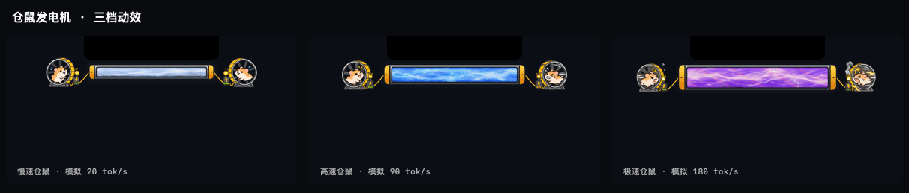

# EmberCat

让 Agent 的输出速度，在菜单栏里跑起来。

EmberCat 是一个 macOS 菜单栏测速宠物。Agent 开始输出，黑猫就会走路、奔跑、滚成一团；也可以换成玛奇玛，看她从步行一路切换到飞行背包。屏幕顶部还有流焰、Matrix 代码雨和仓鼠发电机，跟着输出速度一起变化。

**[下载最新版](https://github.com/johann15910358798-lab/EmberCat/releases/latest)** · [使用指南](docs/usage.md) · [开发指南](docs/development.md) · [更新记录](https://github.com/johann15910358798-lab/EmberCat/releases)

*仓鼠发电机演示，使用模拟的 20 / 90 / 180 tok/s，由应用实际渲染器导出。*

## 能做什么

| 功能 | 你会看到什么 |
| --- | --- |
| 菜单栏宠物 | 黑猫随速度走、跑、滚；玛奇玛随速度切换步行、轮滑、自行车等动作。可在旁边显示实时 `tok/s`。 |
| 屏幕顶部特效 | 流焰、Matrix 代码雨、仓鼠发电机三选一，支持实时预览和参数调整。无刘海的屏幕也能使用。 |
| Dock 小猫 | 沿 Dock 跑圈，留下可调色的荧光脚印；停下来时坐在 Dock 上，眼睛跟随鼠标。 |
| 来源详情 | 查看各来源的实时输出速度、今日输出量、会话和生成状态；估算部分单独标注。 |

测速核心来自 **[Agent Speed](https://github.com/zoefix/agent-speed)**，读取本机已有的会话记录。支持 Codex、Claude Code、Claude Desktop 的本地会话、Gemini CLI、OpenCode、DSH、oh-my-pi、Antigravity、WorkBuddy、WorkBuddy AI、ZCode、Kimi Code CLI 和 Grok Build；实际可见来源取决于本机记录。

## 安装

需要 **macOS 14 或更高版本、Apple Silicon Mac**。

1. 到 [Releases](https://github.com/johann15910358798-lab/EmberCat/releases/latest) 下载 DMG。
2. 将 `EmberCat.app` 拖入「应用程序」，然后启动。
3. 开始使用你的 Agent，EmberCat 会自动发现本地来源。

已安装的版本可在菜单中选择「检查更新…」。0.6.14 及更早版本需手动安装一次新版，见[安装与更新说明](docs/usage.md#安装与更新)。当前发布包采用 ad-hoc 签名，尚未做 Apple 公证。

## 开始使用

点击菜单栏里的宠物即可打开菜单。

- **看速度**：打开「显示实时速度」，或进入「Token 来源」看各来源详情。
- **换玩法**：在「形象」里切换黑猫与玛奇玛；打开「刘海特效」，选择喜欢的样式。
- **调效果**：进入「特效设置与预览…」，拖动参数查看效果，点击「保存并应用」生效。
- **让猫逛 Dock**：打开「绕 Dock 跑圈」。如果提示缺少辅助功能权限，可通过菜单里的「允许…」前往授权。

仓鼠发电机在鼠标经过时淡出隐藏，移开后恢复；Matrix 黑洞在鼠标经过时虚化。顶部特效和 Dock 小猫都保持点击穿透。

## 文档

| 想了解什么 | 去哪里看 |
| --- | --- |
| 特效参数、来源说明、常见问题 | [使用指南](docs/usage.md) |
| 从源码构建、运行检查、导出预览 | [开发指南](docs/development.md) |
| 原画、动画素材、离线重建与来源 | [素材说明](docs/artwork.md) |
| 签名、自动更新与发布流程 | [发布流程](docs/updates.md) |
| 每个版本改了什么 | [GitHub Releases](https://github.com/johann15910358798-lab/EmberCat/releases) |

## 致谢

- **[Agent Speed](https://github.com/zoefix/agent-speed)** 提供 Token 检测与测速核心。原始版权和 MIT 许可保留在 [AGENT-SPEED-LICENSE](Vendor/AGENT-SPEED-LICENSE)，集成信息见[上游记录](Vendor/UPSTREAM.md)。
- 特别感谢 **[s13k（@s0xDk）](https://github.com/s0xDk)** 开源 **[Ghostty Blackhole](https://github.com/s0xDk/ghostty-blackhole)**。Matrix 黑洞参考了它的光线弯曲与吸积盘实现；[参考与改编说明](Vendor/GHOSTTY-BLACKHOLE.md)及 [MIT 许可](Vendor/GHOSTTY-BLACKHOLE-LICENSE)均保留在仓库中。
- 黑猫为本项目原创形象，玛奇玛为同人图像。PixelFX、来源图标及其他依赖的出处见[素材说明](docs/artwork.md#来源与许可)。
